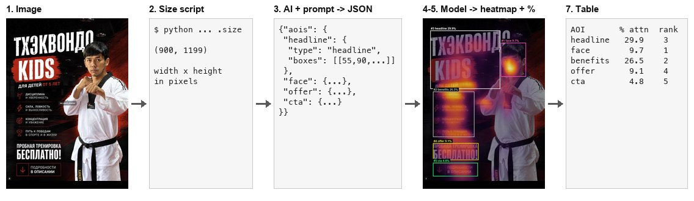
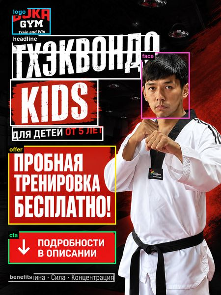
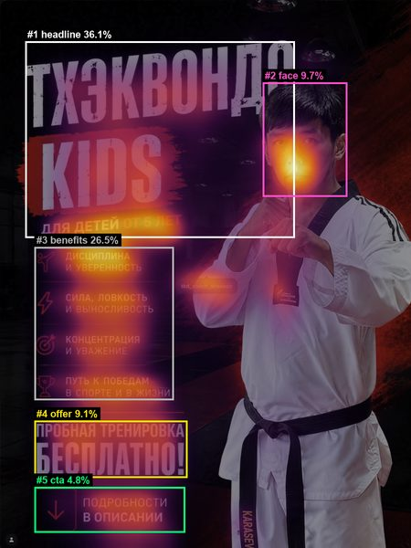
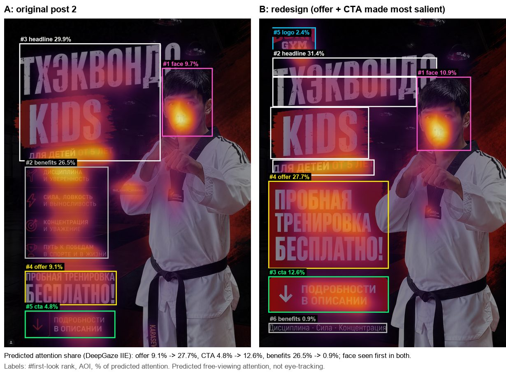
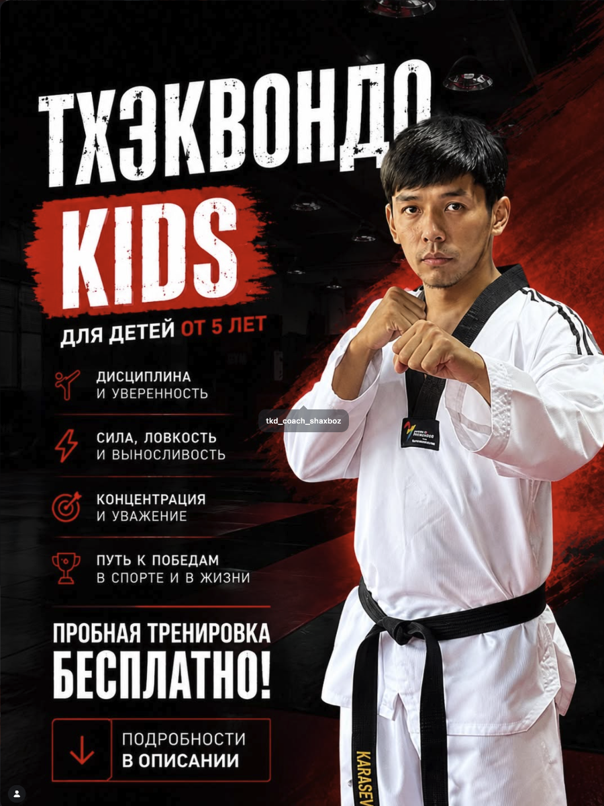
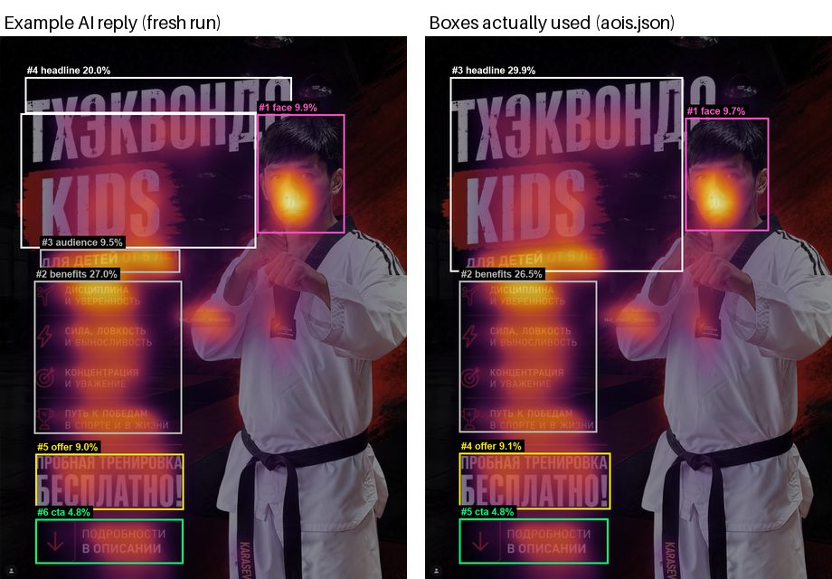
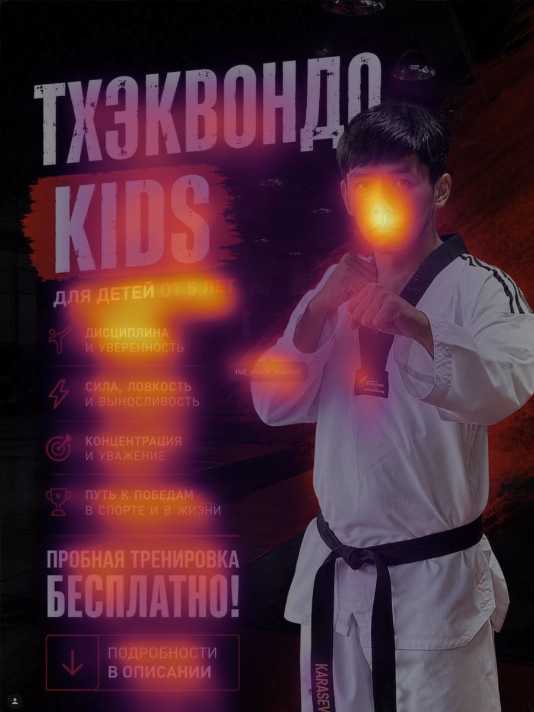

# Analysis guide: new posts and redesigns

How to analyse any image, a new post or an AI redesign, and get the same attention
statistics as the five original posts. For details, see
[AOI_GENERATION.md](AOI_GENERATION.md) (AOI boxes) and [REDESIGN.md](REDESIGN.md)
(making a redesign). Run every command from the repository root after
`./setup.sh` (see the README).

> **Rules**
> - Fix the AOI boxes **before** you look at the heatmap. Afterwards, correct them
>   only for clear placement errors (a box missing its element, or an overlap), and
>   record the correction.
> - Never hand-edit numbers or images in `output/` or `results/`. Regenerate them.
> - The output is **predicted** free-viewing attention (DeepGaze IIE), not
>   eye-tracking.

In the examples below, `post6_class_schedule` is a new post and `post2_v1` is a
redesign of post 2. Replace them with your own names.

The whole flow at a glance, using post 2 as the example (full walk-through in
[Worked example](#worked-example-post-2-taekwondo-kids)):



## 1. Prepare the image

- Export or screenshot the post at native resolution, about 900 px wide like the
  others. Do not upscale.
- Crop away the Instagram interface (header, buttons, caption) so only the post
  itself remains. If a small overlay can't be removed, leave it and note it (see
  D10).
- Save it as PNG in `data/posts/`:
  - new post: `data/posts/<postN>_<short_name>_original.png`, e.g. `post6_class_schedule_original.png`
  - redesign: `data/redesigns/<postN>_v<k>.png`, e.g. `post2_v1.png` (made by [REDESIGN.md](REDESIGN.md))

## 2. Get the image size

```bash
.venv/bin/python -c "from PIL import Image; print(Image.open('data/posts/post6_class_schedule_original.png').size)"
```

This prints `(width, height)`. For post 2 it prints `(900, 1199)`
([example](#step-2--image-size)).

## 3. Generate the AOIs with the AI prompt



Claude proposes the boxes, you review them, and `apply` adds them. This replaces
step 4. Details, options, review rules and examples:
[AOI_GENERATION.md](AOI_GENERATION.md).

```bash
.venv/bin/python -m src.annotate run data/posts/post6_class_schedule_original.png      # needs ANTHROPIC_API_KEY
.venv/bin/python -m src.annotate apply provenance/aois/post6_class_schedule.json --label "Class schedule"
```

Without the API, give the prompt to any multimodal assistant by hand
([AOI_GENERATION.md §6](AOI_GENERATION.md#6-manual-alternative)), then go on to step 4.

## 4. Add the entry to `data/aois.json`

Add a new top-level key: the post name without `_original`. Its value holds the
image path relative to `data/`, a short display label, and the `aois` object from the reply:

```json
"post6_class_schedule": {
  "image": "posts/post6_class_schedule_original.png",
  "label": "Class schedule",
  "aois": {
    "headline": {"type": "headline", "boxes": [[60, 120, 840, 380]]},
    "cta":      {"type": "cta",      "boxes": [[150, 1040, 750, 1120]]}
  }
}
```

- Allowed types: `logo`, `headline`, `face`, `offer`, `cta`, `body`, `visual`.
- Boxes are `[x0, y0, x1, y1]` integer pixels in the original image (top-left, bottom-right).
- An AOI can have several boxes, e.g. one per face.

Validate the file:

```bash
.venv/bin/python -c "from pathlib import Path; from src.buka_attention.schemas import load_specs; print(list(load_specs(Path('data/aois.json'))))"
```

It prints all post keys. A typo, such as an unknown type, a missing field or a
non-integer coordinate, stops with a `ValidationError` naming the problem.

## 5. Run the model and check the boxes

```bash
.venv/bin/python -m src.buka_attention --only post6_class_schedule
```

- The first run downloads the model weights, about 1–2 GB.
- `--only` runs the model and draws heatmaps for the named post only. The tables
  in `output/` still list every post: the others are recomputed from their saved
  densities, and a post that has never been run is left out with a warning.
  `results/` is not touched.
- A box that extends past the image edge is logged as
  `WARNING aoi_box_outside_image ...`. Fix that box, because only its part inside
  the image counts.

Open `output/heatmaps/post6_class_schedule_aoi.png`, and check that each box
covers its element and that no boxes overlap. Overlaps show up as the shares
adding to more than 100%:

```bash
.venv/bin/python -c "import csv; print(round(sum(float(r['share_pct']) for r in csv.DictReader(open('output/stats_aoi.csv')) if r['post']=='post6_class_schedule'), 2))"
```

The result must be `100.0`. If a box is wrong, fix it in `data/aois.json` and
recompute without re-running the model:

```bash
.venv/bin/python -m src.buka_attention --only post6_class_schedule --skip-model
```

Record every correction (old box → new box, and why), as was done for D8.

Good vs bad, for post 2 ([example](#step-5--run-then-check-the-boxes)):

| Good: boxes cover their elements, shares sum to 100% | Bad: headline overlaps the face, shares sum to 104.94% |
|---|---|
|  |  |

## 6. Redesigns



The whole flow (generate an AI redesign, check it, fit it, AOIs, compare) is in
[REDESIGN.md](REDESIGN.md). The comparison itself:

```bash
.venv/bin/python -m src.buka_attention --only post2_taekwondo_kids post2_v1 \
    --skip-model --compare post2_taekwondo_kids:post2_v1
```

`--skip-model` needs both posts' saved densities in `output/density/`; drop it on
a post's first run. Output: `output/compare.csv` and the end of `output/stats.md`.

## 7. Update the published results

To refresh `results/`, `output/` must hold every post. The simplest way is a
full run:

```bash
.venv/bin/python -m src.buka_attention --images data --aois data/aois.json \
    --out output --centerbias centerbias_mit1003.npy
```

Check that the original posts' rows in `output/` are unchanged against
`results/`. Then copy `output/stats*.csv`, `output/stats.md` (and
`output/compare.csv` if used) and `output/heatmaps/*.png` into `results/`.

## 8. Document it

- [AI_USE_AND_PROMPTS.md](AI_USE_AND_PROMPTS.md): add the AOI record from step 3
  (tool, model, date, prompt, raw reply). For a redesign, also add the
  image-generation tool and the exact prompt for each variant to §4.
- [DECISIONS.md](DECISIONS.md): add a new `Dn` entry for anything decided
  (a new post, AOI corrections, a redesign brief). Never edit an existing entry.
- `docs/METHOD.md`: add the post to the stimuli table in §1.

## 9. Commit and push checklist

```bash
.venv/bin/ruff check . && .venv/bin/ruff format --check .
.venv/bin/pytest
grep -rniE "<your name>|/Users/|/home/" $(git ls-files) || echo "no names or local paths"
git config user.name && git config user.email   # must be the student ID and its GitHub noreply address
git add data/ provenance/ results/ docs/ && git commit -m "Add <post key>: AOIs and results"
git push origin main
```

`output/` and the `.npy` density files are git-ignored on purpose. Commit only
the copies in `results/`.

---

## Worked example: post 2 (Taekwondo Kids)

Steps 1–7 above, run on a real post. All outputs below are real. The images are
reduced to 450 px wide for this page.

### Step 1 – the input image

`data/posts/post2_taekwondo_kids_original.png`



### Step 2 – image size

```console
$ .venv/bin/python -c "from PIL import Image; print(Image.open('data/posts/post2_taekwondo_kids_original.png').size)"
(900, 1199)
```

### Step 3 – AOI prompt and reply

The §1b prompt, with the size filled in (only the first lines change):

```
You are annotating areas of interest (AOIs) on a social-media marketing image for an
attention study. The image is 900 x 1199 pixels.
... (rest of the prompt exactly as in AI_USE_AND_PROMPTS.md §1b)
```

**Example reply (Claude, 31 Oct 2026).** This is a fresh run by an assistant that
had not seen `data/aois.json`, given only the image and the prompt above. The reply is
shown verbatim:

```json
{"aois": {"headline": {"type": "headline", "boxes": [[55, 90, 645, 170], [45, 170, 566, 468]]}, "face": {"type": "face", "boxes": [[568, 172, 762, 435]]}, "audience": {"type": "body", "boxes": [[88, 470, 398, 522]]}, "benefits": {"type": "body", "boxes": [[75, 540, 402, 878]]}, "offer": {"type": "offer", "boxes": [[78, 922, 406, 1046]]}, "cta": {"type": "cta", "boxes": [[78, 1066, 405, 1165]]}}}
```

Left: that reply's boxes. Right: the boxes actually used in the study.



The two sets differ slightly. The fresh reply split the "for children from 5" line
into its own `audience` AOI and stepped the headline around the face, so its
headline share is 20.0% against 29.9%. The face, benefits, offer and CTA shares stay
within 0.5 points. Differences like this are why the published `data/aois.json`, not
the prompt, is what reproduces the numbers.

### Step 4 – the `data/aois.json` entry and validation

```json
"post2_taekwondo_kids": {
  "image": "posts/post2_taekwondo_kids_original.png",
  "label": "Taekwondo Kids free trial",
  "aois": {
    "headline": {"type": "headline", "boxes": [[55, 90, 570, 520]]},
    "face":     {"type": "face",     "boxes": [[575, 180, 760, 430]]},
    "benefits": {"type": "body",     "boxes": [[75, 540, 380, 875]]},
    "offer":    {"type": "offer",    "boxes": [[75, 920, 410, 1045]]},
    "cta":      {"type": "cta",      "boxes": [[75, 1065, 405, 1165]]}
  }
}
```

```console
$ .venv/bin/python -c "from pathlib import Path; from src.buka_attention.schemas import load_specs; print(list(load_specs(Path('data/aois.json'))))"
['post1_brand_flag', 'post2_taekwondo_kids', 'post3_trainer_rental', 'post4_boxing_open_ring', 'post5_special_offer', 'post2_v1']
```

### Step 5 – run, then check the boxes

```console
$ .venv/bin/python -m src.buka_attention --only post2_taekwondo_kids
INFO post_started post=post2_taekwondo_kids
INFO model_loading name=DeepGazeIIE device=cpu
INFO run_finished out=output posts_run=1 posts_in_tables=5

$ .venv/bin/python -c "import csv; print(round(sum(float(r['share_pct']) for r in csv.DictReader(open('output/stats_aoi.csv')) if r['post']=='post2_taekwondo_kids'), 2))"
100.0
```

| `output/heatmaps/post2_taekwondo_kids_heatmap.png` | `output/heatmaps/post2_taekwondo_kids_aoi.png` |
|---|---|
|  |  |

**What a bad box looks like.** This is the first version of the boxes
(`provenance/aois/aois_v0_before_overlap_fix.json`). The headline box ran into the face box,
so the coach's face was counted twice. The shares summed to **104.94%**, and the
headline took credit for the face hotspot (36.1% instead of 29.9%). The fix moved
the headline's right edge from 645 to 570 (D8).


### Step 7 – the resulting table (from `stats.md`)

| AOI | Type | % attention | % area | Lift | First-look rank |
|---|---|---|---|---|---|
| headline | headline | 29.9 | 20.5 | 1.46 | 3 |
| face | face | 9.7 | 4.3 | 2.26 | 1 |
| benefits | body | 26.5 | 9.5 | 2.79 | 2 |
| offer | offer | 9.1 | 3.9 | 2.36 | 4 |
| cta | cta | 4.8 | 3.1 | 1.57 | 5 |
| (rest of image) | other | 20.0 | 58.8 | 0.34 |  |

The face is predicted to be seen first. The CTA gets 4.8% of attention on 3.1% of
the area.
