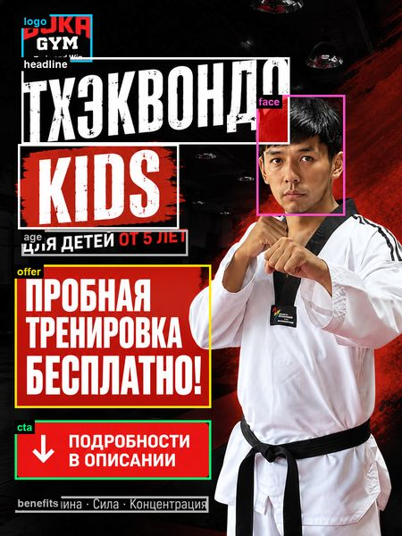
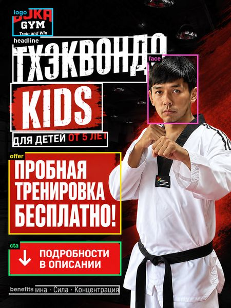

# AOI generation

How AOI boxes are proposed by AI, checked, reviewed and added to `aois.json`.
Quick path: [ADD_A_POST.md step 3](ADD_A_POST.md#3-generate-the-aois-with-the-ai-prompt).
Decisions: D7, D8, D14, D17, D19.

> **Rules**
> - AOIs are fixed **before** any heatmap of the image exists.
> - The five published posts keep their boxes (D17).
> - Every raw AI reply is kept.

## 1. Prompt

`prompts/aoi_annotation.txt` is the single source of the prompt. It is quoted in
[AI_USE_AND_PROMPTS.md §1b](AI_USE_AND_PROMPTS.md#1b-reusable-prompt-to-replicate-the-annotation),
and a test fails if the two differ. `{WIDTH}`/`{HEIGHT}` are filled with the size of
the image actually sent.

## 2. Run

With `ANTHROPIC_API_KEY` set ([REDESIGN.md §0](REDESIGN.md#0-api-keys)):

```bash
.venv/bin/python -m src.annotate run images/post2_v1.png
```

| Option | Default | Note |
|---|---|---|
| `--key` | image name without `_original` | Post key in `aois.json` |
| `--model` | `claude-opus-5-5` | The model that actually answered is recorded as `model_used` |
| `--effort` | `high` | `low` … `max` |
| `--out` | `aois_generated/` | Use a subfolder for robustness re-annotations |

- **Scaling:** images with a long edge over 1568 px are downscaled before
  sending; the boxes are scaled back to original pixels and the scale is recorded.
- **API call:** pydantic-ai native structured output, so no forced tool call and
  no sampling parameters.
- **No overwrite:** an existing staging file is never overwritten.

**Output:**

- `aois_generated/<key>.json`: the proposed `aois.json` entry.
- `aois_generated/<key>.meta.json`: the audit record. It holds the model requested
  and used, effort, the prompt and its SHA-256, the image SHA-256, sizes and
  scale, the request ID, token usage, the raw reply, and the problems found.

## 3. Automatic checks

Each reply is checked for:

- overlaps between AOIs;
- zero-size or inverted boxes;
- boxes past the image edge.

Each problem is logged as `WARNING aoi_problem ...` and stored in `problems`.
`apply` refuses an entry until every problem is fixed.

## 4. Review

Done before any heatmap exists:

1. Keep the raw reply: `cp aois_generated/<key>.json aois_generated/<key>.ai_original.json`.
2. Draw the boxes on the image and check that each covers its element.
3. Fix overlaps by the **D8 rule**: the face keeps its full box, and text boxes are
   trimmed or split at the visible boundary.
4. For a redesign, use the same AOI names and grouping as the original post, so
   `--compare` lines up.
5. Record every change (old box → new box, and why) in a new `Dn` entry.

**Example: variant B of post 2 (D19).** The red areas are the overlaps the checks
flagged.

| Raw AI proposal | After review |
|---|---|
|  |  |

```text
logo      [48, 32, 206, 138]   → [48, 32, 206, 140]                        whole "Train and Win" line, ends at the headline
headline  [48, 128, 648, 322]  → [48, 142, 648, 212] + [48, 212, 574, 322]   split above / beside the face
age       [48, 514, 420, 572]  → merged into headline                      the original post 2 counts this line as headline
```

## 5. Apply

```bash
.venv/bin/python -m src.annotate apply aois_generated/post2_v1.json --label "Taekwondo Kids – variant B"
```

This appends the entry to `aois.json` without reformatting the rest of the file.
It refuses keys already in the file and entries that fail the checks.

## 6. Manual alternative

Give the prompt from §1, with the size filled in, and one image to any multimodal
assistant. Log the tool, model, date, prompt and raw reply in
[AI_USE_AND_PROMPTS.md](AI_USE_AND_PROMPTS.md). Paste the reply into `aois.json`
under the new key (format: [ADD_A_POST.md step 4](ADD_A_POST.md#4-add-the-entry-to-aoisjson)),
then validate it.

## 7. Robustness

AI annotation isn't deterministic, so the published `aois.json`, not the prompt,
reproduces the numbers. A blind re-annotation of post 2 came within 0.5 points on
the face, benefits, offer and CTA shares. The headline differed, 20.0% against
29.9%, because the reply split off the "for children from 5" line.
See [ADD_A_POST.md worked example, step 3](ADD_A_POST.md#step-3--aoi-prompt-and-reply).
