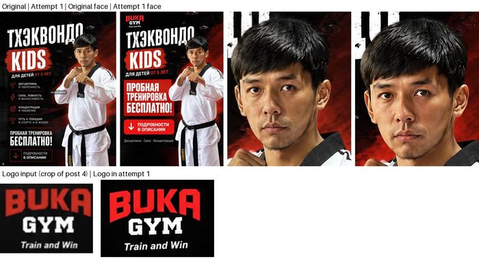
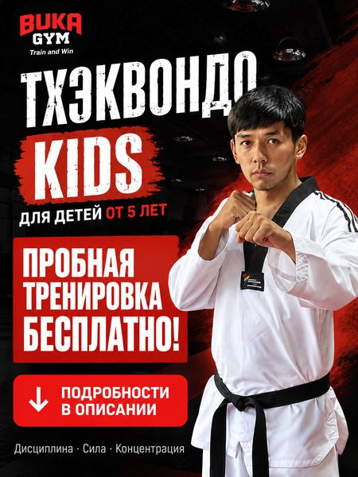
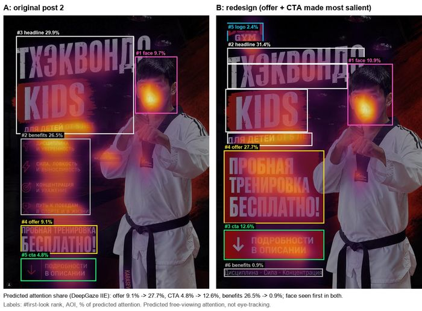

# Redesign runbook (Step 2)

From an original post to a before/after comparison of an AI redesign. Run all
commands from the repository root after `./setup.sh` and
`.venv/bin/pip install -r requirements-dev.txt`. Example: `post2_v1`, variant B
of post 2 (D18, D19).

> **Rules:** acceptance checks and AOI boxes are fixed **before** any heatmap of
> the redesign exists. Keep every attempt and every raw AI reply. Results are
> predicted attention, not eye-tracking.

## 0. API keys

Set the keys in your own terminal. Never paste them into a chat and never commit them.

```bash
export OPENAI_API_KEY=...        # redesign (step 1)
export ANTHROPIC_API_KEY=...     # AOI annotation (step 4)
# or put both in .env (git-ignored) and load it:
set -a; source .env; set +a
```

The scripts only read these variables, and never log or store them.

## 1. Generate an attempt

Purpose: get an AI edit of the original from a fixed prompt.

```bash
.venv/bin/python -m src.redesign generate
```

The defaults are for `post2_v1`. For another post, add
`--name <key> --prompt prompts/<key>.txt --images images/<original>.png redesigns/inputs/buka_logo.png`.
Model: `gpt-image-2.5-sunburst-2026-09-08`, change it with `--model`.

→ `redesigns/<key>_attemptN.png` plus a `.json` record (prompt and its hash,
model, settings, input hashes, request ID). Attempts are numbered; at most 3, and
none is ever overwritten.

## 2. Check the attempt

Purpose: accept or reject the attempt on rules written down in advance, not on
looks or heatmaps.

- Every Cyrillic line is spelled exactly as in the prompt.
- The person keeps the same identity, pose and uniform.
- The logo is not redrawn into something else.
- There is no extra text, people or watermark.

Accept the **first** attempt that passes. Otherwise run step 1 again. Save a
side-by-side check image to `redesigns/` (e.g. `post2_v1_attempt1_check.jpg`).



## 3. Fit to the post size

Purpose: match the original's 900 × 1199 frame.

```bash
.venv/bin/python -m src.redesign finalize redesigns/post2_v1_attempt1.png
```

→ `images/<key>.png` and `redesigns/<key>_final.json`. The default `--fit crop`
cuts the bottom only, to 3:4, then resizes. Before running, check that the cut
strip holds no text or AOI content; if it does, record it as a deviation (D18).
`--fit pad` keeps everything but shrinks the poster and adds side bands.

| Cut strip (bottom 172 px): it held the belt name "KARASEV", logged in D18 | Final `images/post2_v1.png` |
|---|---|
|  |  |

## 4–6. AOIs

Claude proposes the boxes (`src.annotate run`), you review them before any heatmap
exists (keep the raw reply, fix overlaps by the D8 rule, use the original's AOI
names), and `src.annotate apply` adds them. Full procedure and the post2_v1
example: [AOI_GENERATION.md](AOI_GENERATION.md).

```bash
.venv/bin/python -m src.annotate run images/post2_v1.png
.venv/bin/python -m src.annotate apply aois_generated/post2_v1.json --label "Taekwondo Kids – variant B"
```

## 7. Run and compare

```bash
.venv/bin/python -m src.buka_attention --only post2_taekwondo_kids post2_v1 \
    --compare post2_taekwondo_kids:post2_v1
```

→ `output/heatmaps/<key>_heatmap.png` and `_aoi.png`, plus `output/stats.md`
(every post, with a before/after section at the end) and `output/compare.csv`.
Check that each post's shares sum to 100% (see [ADD_A_POST.md step 5](ADD_A_POST.md#5-run-the-model-and-check-the-boxes)).



## 8. Publish

Copy the tables and the new heatmaps from `output/` to `results/`, after checking
that the existing rows are unchanged. Then:

- add the run to [AI_USE_AND_PROMPTS.md §4](AI_USE_AND_PROMPTS.md#4-ai-generated-redesigns-step-2);
- add the stimulus to [METHOD.md §1](METHOD.md#1-stimuli);
- add a `Dn` entry with the result;
- commit (checklist: [ADD_A_POST.md step 9](ADD_A_POST.md#9-commit-and-push-checklist)).
